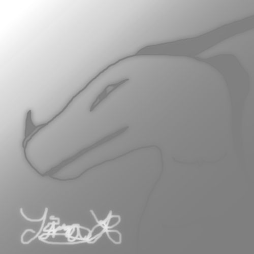
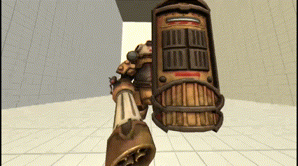

# V2’S Knuckleblaster  
  
## Welcome to my repository, internet prowler...
  
### Image gallery:  

  

**By repleKKa / Tima K**  

  

### Now the serious stuff trust...  (A.K.A. a general explanation)

## What *this* Is  

*This* is a real-world replication of the fictional weapon called the Knuckleblaster from the hit indie game ULTRAKILL by Arsi "Hakita" Patala. The weapon is obtained from killing the Boss V2 in the stage **1-4: CLAIR DE LUNE**, and then picking it up from the ground. The weapon is used by double-tapping the "f" button. By doing this, it creates an explosion in front of the user that damages and blasts enemies away. Here is a demo GIF:  

So this is what I sought/seek/suk/sak to create is a replica of this, in real life. And this is the readme for that :D! While I will be a bit of a joker in some bits like this, but this README will remain true to it's purpose- inform, interest, and entertain. Anyways, go play Ultrakill, make a fork of my project, or go do something at [HackClub](https://hackclub.com). The people over there are great, they're why I did this!

## How to Use  

**Initial setup:**
Power on the Knuckleblaster by flipping the MB_Power switch to on. The servo should unlock instantly. Load the shell in (No HHO) and jerk it up or down. The servo should latch down to grab the shell. Pump your hand forward or pump your hand up again and the servo should unlatch. If you did the forward pump, then the electirc lighter should fire and the solenoid should fire. If this goes smooth, then proceed to the Regular Use section below. If not, then go to the trouble shooting section.  

**Regular use:**  
Jerk your hand up sharply (be carefule not to do the salute 💀) to trigger the IMU unlatch. Load the shell (HHO loaded) [^1] into the slot under the glove. Raise your hand up or down sharply to latch the shell. Make sure that the hand your left hand is properly protected. Then jerk it forward to activate the mechanism. In one second, the electric lighter should fire and then the solenoid should fire immediately, ejecting the shell and then making the gas burst. The latch should unlatch as well. If it doesn't, then jerk your hand upward to unlatch it (through IMU activation).  

## Why I made *this*  

I made this because of [#Fallen @ Hackclub](https://fallen.hackclub.com), because of my love of ULTRAKILL (I am not a larper trust), and because I like making dangerous stuff <3. The chaps (I am not BRITISH) over there are really cool. The way Fallen works is that you work for a few hours a day, and then journal it. Add an image and 200 charachters of text an hour, and ur good (but you should do more work trust). Anyways onto the second reason... ULTRAKILL. Probably one of the most influential indie games in existence. One person made this peak of a game. I ***legally purchased*** the game some time ago, and started playing. While I haven't gotten too far (2-2, please don't kill me) in the game, I am in love with the art style; low-poly machines, rounded angelic figures, and other things/stuff/etc. etc. Originally, I meant to recreate V1's head as a helmet, but that went poorly. I spent 18+ hours on that (sobs quitely in corner) and it didn't work because it was wayyyyy to large and also because Blender kinda sucks. So I yapped in a huddle for like an hour and a halfish until a fellow ultrakill player suggested I make V2's Knuckleblaster. And now the third reason... weapo- *ahem* I mean completely safe and **totally** (I HOPE YOU CAN TELL I AM DRIPPING WITH SARCASM) OSHA compliant. Nerf guns have always interested me so I was like Ultrakill item IRL + weapon + Fallen = the peakest formula in existence. So that's why I made this. Yeah. Now since you read this far, go make something new! 
  
[^1]: Method is not yet devloped to load shell or HHO  

## Image Sources  

- Me
- https://external-content.duckduckgo.com/iu/?u=https%3A%2F%2Fultrakill.wiki.gg%2Fimages%2FKnuckleblaster_gutterman_shield_break.gif%3F74170c&f=1&nofb=1&ipt=6716667dc868ad39618a6990aa4517bac2c8e4df75519246ce3ba1dcdfbfe9a6&ipo=images  
